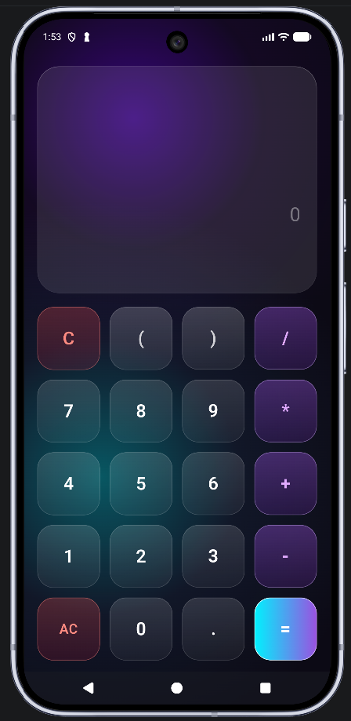
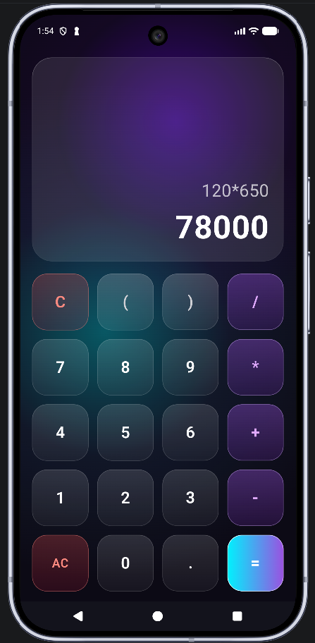

## 📱 Interface & Features

A modern, minimalist dark-mode calculator featuring a **glassmorphism** UI and a soft neon background glow.

* **Ergonomic Design:** Large rounded buttons with distinct color coding for clear actions, math operators, and a vibrant gradient equals button.
* **Dual-Line Display:** Shows the full input expression (including parentheses support) alongside a large, easy-to-read result.

| Main Screen | Expression Calculation |
| :---: | :---: |
|  |  |

